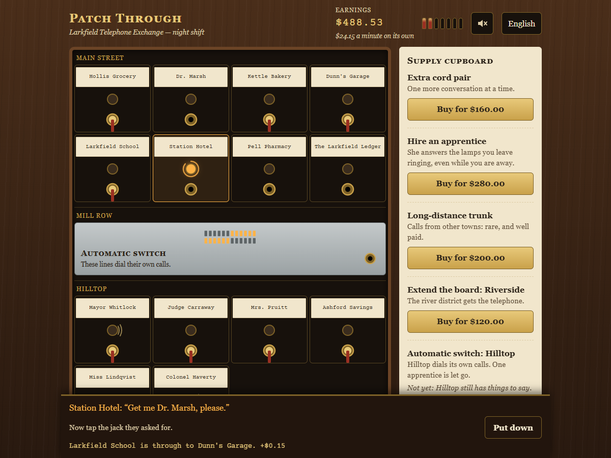

# Patch Through

A small idle game about a night operator at a 1950s small-town telephone
exchange. Calls light up the switchboard and you patch them through by hand.
Little by little, apprentices, then automatic switches, take the work off
your hands, until there is nothing left to plug in.

It has an ending. The exchange goes fully automatic, the position is
abolished, and the credits roll. There is no prestige loop and no exploding
numbers.

**[Play it in your browser](https://krymum.github.io/PatchThrough/)**



## Play

The game runs in any modern browser, on desktop or phone. Tap (or click) a
lit lamp to answer, then tap the jack the caller asks for.

On a keyboard, <kbd>Tab</kbd> and <kbd>Enter</kbd> work everywhere, and a few
shortcuts save time:

| Key               | Action                                 |
| ----------------- | -------------------------------------- |
| <kbd>A</kbd>      | Answer the oldest lit lamp             |
| <kbd>L</kbd>      | Listen in, or take off the earpiece    |
| <kbd>Escape</kbd> | Put the caller down, or stop listening |

Sound can be switched off from the speaker button. Animations are dropped
when your system asks for reduced motion.

Now and then a call carries a conversation worth hearing. Listen in and
you follow five small stories of the town, but while you listen you cannot
work the board. Lamps keep ringing. A district is never automated before
its story has been told, whether or not you listened.

Progress is saved in your browser's local storage. Apprentices and automatic
switches keep earning while you are away, at half rate and for up to four
hours.

## Pacing

A full shift lasts about two and a half hours:

| Stage                  | Around      | What changes                                  |
| ---------------------- | ----------- | --------------------------------------------- |
| The night shift        | 0–15 min    | Main Street, a handful of cords               |
| The town grows         | 15–40 min   | Mill Row and Hilltop join the board           |
| The apprentices        | 40–80 min   | Colleagues answer the lamps you leave ringing |
| The switches           | 80–120 min  | Grey cabinets replace districts, seats empty  |
| Dial telephones        | 120–140 min | Only long-distance calls still need you       |
| The automatic exchange | ~140 min    | The board falls silent                        |

`src/game/balance.test.ts` plays the whole game with a scripted operator and
fails if a stage drifts outside its window, so tuning stays honest.

## Run it locally

Requires Node.js 22 or later.

```sh
npm install
npm run dev       # start the dev server
npm test          # run the unit tests
npm run lint      # ESLint + Prettier check
npm run build     # type-check and build the static site into dist/
```

## How the code is organised

```
src/
  game/      Pure TypeScript game logic: no React, no DOM, fully unit-tested.
    config.ts       Every balance value, in one place.
    engine.ts       Event-driven, seeded simulation (deterministic).
    progression.ts  Districts, apprentices and income, derived from purchases.
    story.ts        Plots, story calls and listening in.
    offline.ts      Capped catch-up for time spent away.
    save/           Versioned save format, migrations, guarded storage access.
  audio/     Sounds synthesised with the Web Audio API, and which events trigger them.
  content/   All player-facing text. English is the reference; French is
             type-checked against it, so a missing string fails the build.
  ui/        React components, styles, and the single hook bridging React
             to the engine.
```

## Contributing

Issues and pull requests are welcome.

- Keep game rules in `src/game/` and cover them with tests.
- Put tuning numbers in `src/game/config.ts`, not in the code that uses them.
- Add new text to both `src/content/en` and `src/content/fr`.
- Commit messages follow [Conventional Commits](https://www.conventionalcommits.org/).
- `npm run lint`, `npm test` and `npm run build` must pass with no warnings;
  CI runs the same checks on every push.

## Credits

All code, text, graphics and sounds are original to this project. Graphics
are drawn with SVG and CSS and sounds are synthesised in the browser: the
game uses no bitmap images and no audio files.

The typewriter face is [Courier Prime](https://github.com/quoteunquoteapps/CourierPrime),
© The Courier Prime Project Authors, used under the SIL Open Font License 1.1
(see [src/ui/fonts/OFL.txt](src/ui/fonts/OFL.txt)). The town of Larkfield and everyone in it are
fictional.

## License

[MIT](LICENSE)
